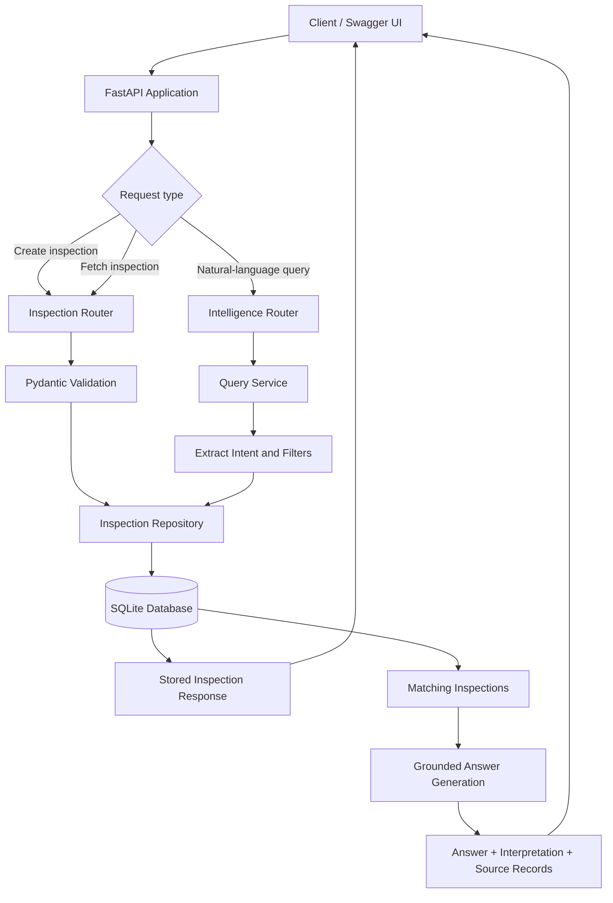
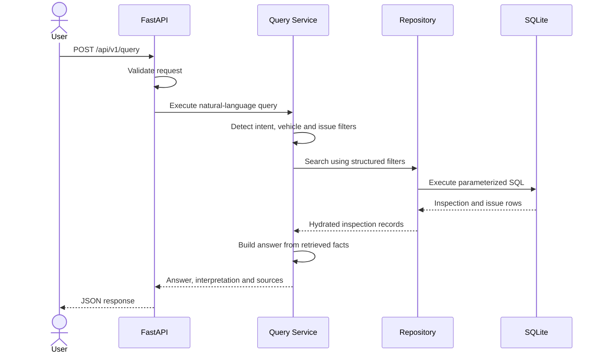

# Vehicle Intelligence Platform — Design

## Goals

Store structured vehicle inspection reports and answer common operational questions expressed in natural language. The first version favors predictable behavior, traceability, and a zero-cost local setup over an opaque external LLM dependency.

## Architecture

```text
Client -> FastAPI routes -> Query service -> Repository -> SQLite
                     |          |
                 Pydantic   intent + filters
                 validation  + answer synthesis
```

## Request flow diagram



### Natural-language query sequence



- **API layer** owns HTTP semantics and schema validation.
- **Query service** translates domain phrases into a small intent/filter representation and synthesizes an answer from retrieved facts. Every response exposes that interpretation for auditability.
- **Repository** owns parameterized SQL and maps normalized rows into API resources.
- **SQLite** provides transactions, indexes, constraints, and a frictionless reviewer setup. The repository boundary allows migration to PostgreSQL without changing the HTTP contract.

## Project structure

```text
app/
├── core/             # Settings and cross-cutting configuration
├── db/               # SQLite connection lifecycle and schema
├── inspections/      # Inspection schemas, repository, dependencies, routes
├── intelligence/     # Natural-language schemas, service, routes
├── system/           # Operational endpoints
└── main.py            # Application factory and router composition
scripts/               # Seed and operational scripts
tests/                 # API integration tests
```

## Data model

An `inspection` captures the vehicle snapshot, inspector, outcome, notes, and timestamp. An inspection has zero or more `issues`; each issue records a category, component, severity, description, and estimated repair cost. Issues are separate rows so category/severity queries remain indexable.

Multiple inspections may exist for one `vehicle_id`, preserving history. The latest endpoint resolves by timestamp and then ID.

## Natural-language strategy

The parser recognizes:

- intents: explain a decision, summarize one inspection, or search;
- vehicle identifiers such as `CAR-1002`;
- outcomes and issue severity;
- domain category aliases such as motor/engine, gearbox/transmission, and tyre/tire.

It creates parameterized filters rather than generating SQL. This prevents prompt-to-SQL injection and makes results reproducible. Unknown questions safely degrade to a broad search; unmatched filters return a clear empty result.

For a larger vocabulary, the parser can be replaced with an LLM that emits a validated `QueryInterpretation` object. Retrieval and answer generation should remain grounded in repository results. In production I would also add confidence thresholds and request clarification for ambiguous queries.

## Production evolution

- PostgreSQL plus Alembic migrations and connection pooling.
- Authentication and role-based authorization; vehicle and tenant scoping.
- Idempotency keys on report ingestion and an audit event log.
- Pagination with stable cursors, structured request logs, metrics, and tracing.
- Async job processing for image/OCR inspection uploads.
- Hybrid full-text/vector retrieval for free-form notes, with evaluation datasets for query accuracy.
- Versioned inspection schemas and soft deletion according to retention policy.

## Trade-offs

The rule-based parser covers the assignment examples and adjacent vocabulary without latency, cost, nondeterminism, or secrets. It is intentionally not a general conversational agent. SQLite is ideal for evaluation and single-instance deployment but is not the proposed multi-writer production datastore.
