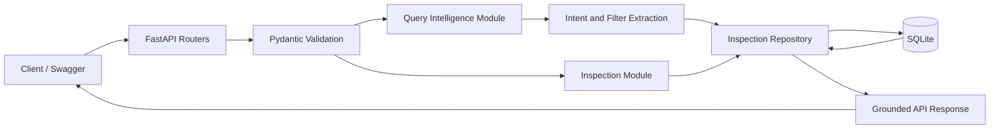

# Vehicle Intelligence Platform

A FastAPI backend for Cars24 Problem 3. It stores structured vehicle inspection reports and answers natural-language questions with evidence from those reports.

## Features

- Create and retrieve normalized inspection reports and issues.
- Find the latest inspection for a vehicle.
- Ask questions such as:
  - `Why was vehicle CAR-1002 rejected?`
  - `Show all cars with engine issues.`
  - `Summarize inspection for CAR-1004.`
- Transparent intent/filter interpretation in every query response.
- SQLite constraints, indexes, transactions, parameterized queries, seed data, tests, and generated OpenAPI docs.
- No paid service or API key required.

## Application flow



The detailed request and sequence diagrams are available in [DESIGN.md](DESIGN.md).

## Quick start

Python 3.11+ is recommended.

```bash
python -m venv .venv
source .venv/bin/activate
pip install -r requirements-dev.txt
cp .env.example .env
python -m scripts.seed
uvicorn app.main:app --reload
```

Open interactive API documentation at <http://127.0.0.1:8000/docs> or ReDoc at <http://127.0.0.1:8000/redoc>.

Run tests:

```bash
pytest -q
```

## API

All endpoints use the `/api/v1` prefix.

| Method | Path | Purpose |
|---|---|---|
| `GET` | `/health` | Database readiness check |
| `POST` | `/inspections` | Store an inspection and its issues |
| `GET` | `/inspections/{id}` | Fetch an inspection |
| `GET` | `/vehicles/{vehicle_id}/latest-inspection` | Fetch latest vehicle inspection |
| `POST` | `/query` | Query reports in natural language |

Example query:

```bash
curl -sS http://127.0.0.1:8000/api/v1/query \
  -H 'Content-Type: application/json' \
  -d '{"query":"Why was vehicle CAR-1002 rejected?"}'
```

The response contains a concise answer, the parsed intent and filters, matching source records, and a count. Returning sources keeps generated summaries inspectable instead of asking clients to trust an unsupported answer.

Example write:

```bash
curl -sS http://127.0.0.1:8000/api/v1/inspections \
  -H 'Content-Type: application/json' \
  -d '{
    "vehicle_id":"CAR-2001", "make":"Toyota", "model":"Innova", "year":2023,
    "odometer_km":18000, "inspector":"Asha Mehta", "decision":"approved",
    "notes":"Road test passed", "issues":[]
  }'
```

## Configuration

| Variable | Default | Description |
|---|---|---|
| `APP_ENV` | `development` | Environment label |
| `DATABASE_PATH` | `data/vehicle_intelligence.db` | SQLite file path |
| `LOG_LEVEL` | `INFO` | Application log level |

See [DESIGN.md](DESIGN.md) for architecture, trade-offs, and the production roadmap.

## Project structure

The application is organized by feature rather than by technical file type:

```text
app/
├── core/             # Configuration
├── db/               # Database lifecycle and schema
├── inspections/      # Inspection API, schemas, repository
├── intelligence/     # Natural-language API and service
├── system/           # Health endpoint
└── main.py            # FastAPI composition root
scripts/               # Seed data tooling
tests/                 # Integration tests
```
# vehicle-intelligence-platform
